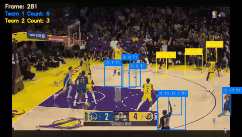
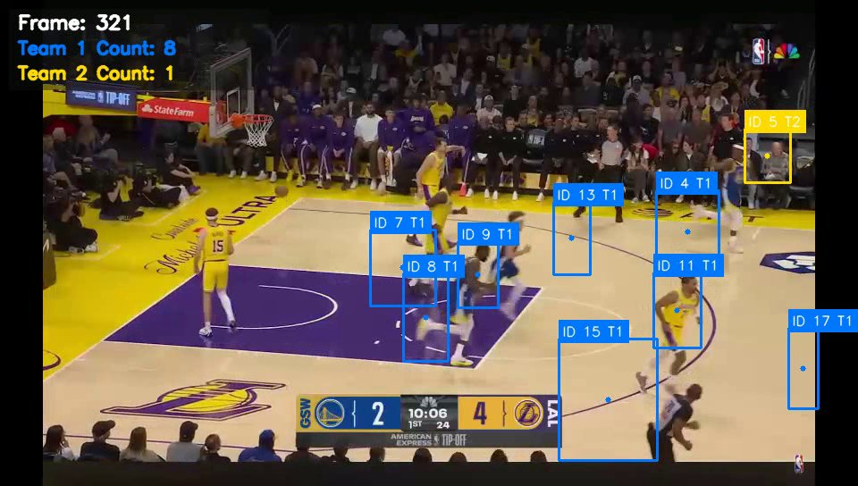
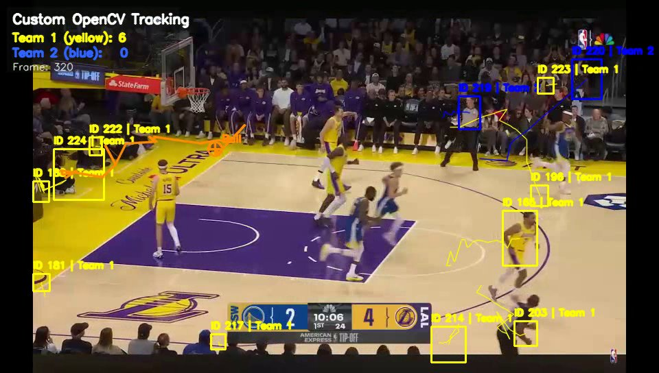

# opencv_basketball_tracker

Player and ball tracking on a basketball broadcast clip using only OpenCV
and NumPy. There's no deep learning in here. I wanted to see how far
background subtraction, colour masks and a hand-written tracker could get
before reaching for YOLO. The answer is "partway".



## What's in here

There are two versions. I wrote them in March 2026 and they take different
approaches:

- `basketball_player_tracking_opencv.py` is the bigger one (about 750
  lines) and the one I'd call the main version.
  - **Players:** MOG2 background subtraction finds them, and a court-region
    gate throws away the bench and crowd.
  - **Tracker:** IoU and distance matching, with a track confirmed after 3
    hits.
  - **Teams:** split by clustering a hue histogram of each player's jersey
    patch.
  - **Ball:** candidates are scored on orange colour, motion, edge energy,
    circularity and distance from where the ball was predicted to be. It
    searches the whole frame and also a 110 px window around the last
    position.
- `basketball_tracking_pipeline.py` is a shorter rewrite with a CLI.
  - **Teams:** fixed HSV ranges (yellow vs blue, tuned for this clip).
  - **Ball:** a `cv2.KalmanFilter` (constant velocity) tracks it.

## Running it

Tested with Python 3.12, OpenCV 4.6 and NumPy 1.26.

```bash
pip install -r requirements.txt
python3 basketball_player_tracking_opencv.py --input input.mp4 --output out.mp4
# --no-display to skip the preview window

python3 basketball_tracking_pipeline.py --input input.mp4 --output out_pipeline.mp4
```

I haven't included the input video, because it's a clip of an NBA broadcast
(Warriors at Lakers) and isn't mine to share. Any wide broadcast-angle clip
works, but the colour thresholds and the court crop fractions
(`COURT_TOP_FRAC` etc.) are tuned for a 960x544 frame of that game. You'll
need to retune them for anything else.

## How it does

On my 20.6 s clip (618 frames, 960x544, 30 fps), each script takes about 9 s
on a laptop CPU, so a bit faster than real time.

| | main version | pipeline version |
|---|---|---|
| player IDs created | 22 | 213 |
| frames with a ball marker | 317 of 618 | - |

The main version keeps IDs much more stable. The pipeline version re-spawns
a new ID almost every time a player is lost for a moment, so by frame 500
it's into the 300s.

Main version, frame 321:



Pipeline version, same frame:



## Known issues

- **Team split is unreliable.** In the frame above, most players in both
  jerseys end up as T1. The jersey patch picks up a lot of floor (the court
  is yellow-ish too), and the Warriors' blue and the Lakers' purple overlap
  in hue.
- **Merged boxes.** When two players overlap, background subtraction gives
  one blob, so they get one box. Box 15 in the screenshot is a defender plus
  part of the referee.
- **Crowd and bench leak in** near the edges of the court crop (box 5 in the
  screenshot is a fan).
- **The ball marker is mostly wrong.** It's on screen about half the time.
  When I looked at 18 sampled frames, it was on the ball in only a couple. The
  rest of the time it sat on jerseys, skin, the crowd or the sideline. At this
  resolution the ball is about 10 px across and its colour is close to the
  floor and the Lakers' yellow, so colour plus circularity doesn't separate
  it.
- **Camera cuts and pans break background subtraction.** The clip has a few
  close-ups, and after each cut or fast pan everything is "foreground" for a
  while.

If I picked this up again, I'd keep the tracker and swap the detector for a
small YOLO model. The detection side is where most of the errors come from.
